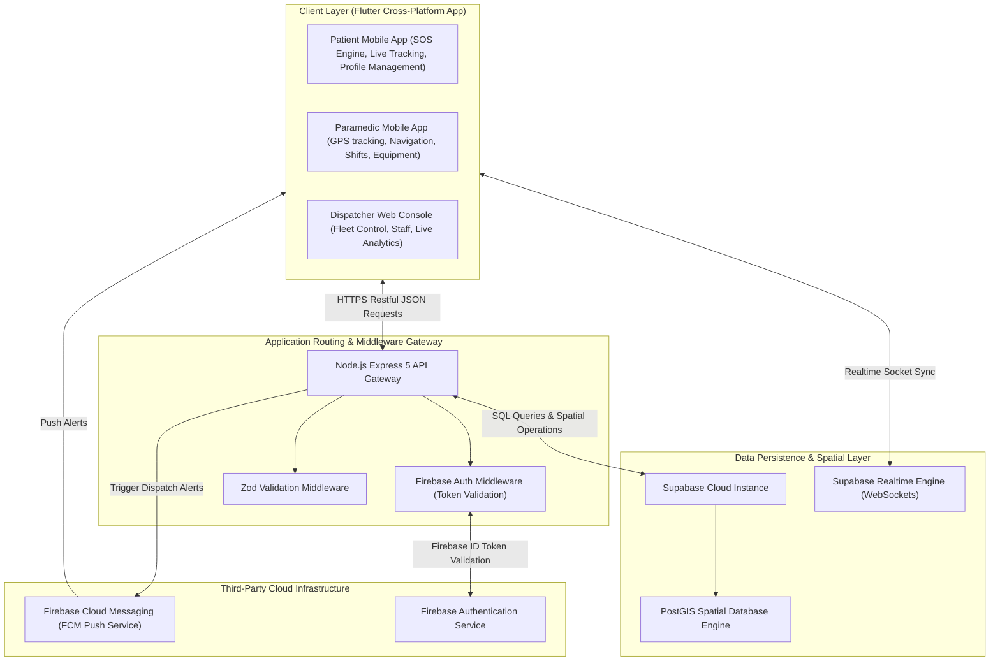
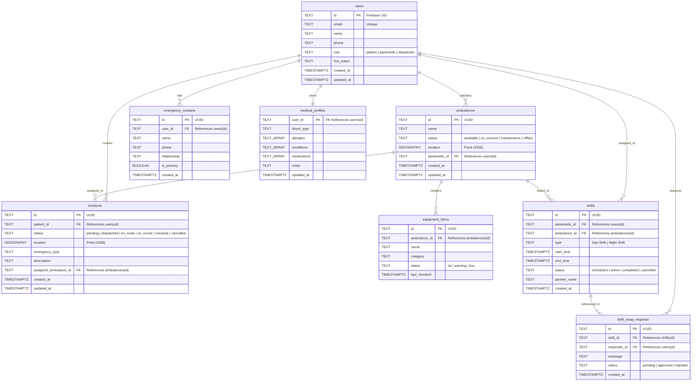
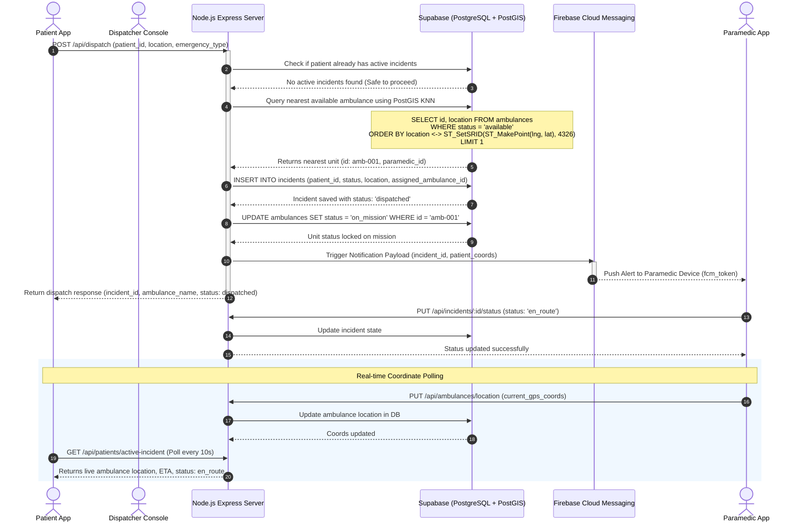
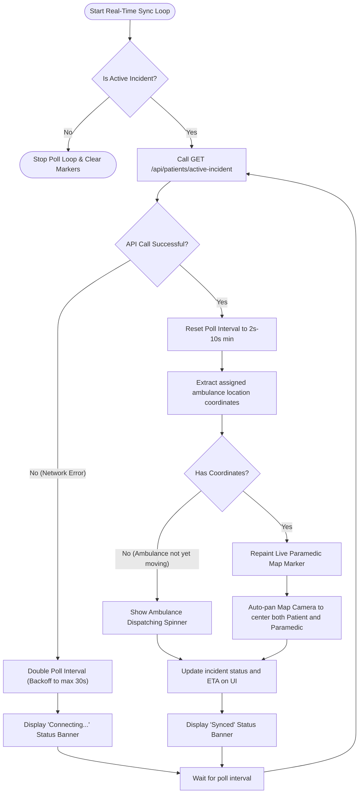
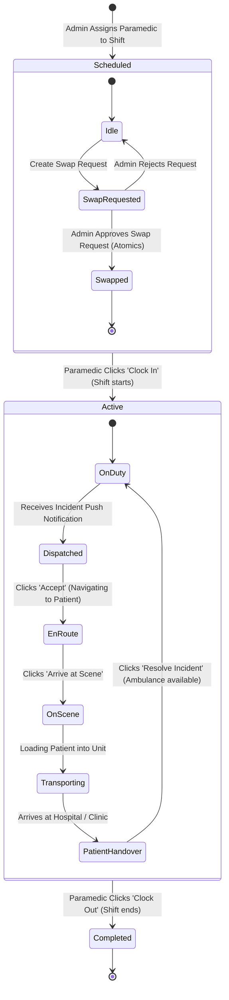
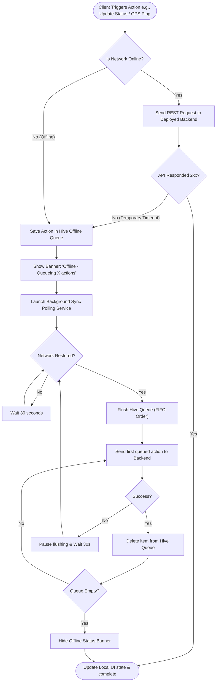

# SEADS Thesis Diagrams Repository — Chapters 3 and 4

This document serves as the official diagrams repository for the **Smart Emergency Ambulance Dispatch System (SEADS)** academic thesis. It contains [Mermaid](https://mermaid.js.org/) diagram specifications for **Chapter 3 (Methodology & System Architecture)** and **Chapter 4 (System Implementation, State Flows, and Reliability)**.

These diagrams can be rendered in Markdown viewers, GitHub, or pasted into the [Mermaid Live Editor](https://mermaid.live/) to export in high-resolution vector (SVG) or image (PNG) formats for inclusion in your thesis document.

---

## 📘 Chapter 3: Methodology and System Architecture

This chapter focuses on the design methodology, high-level framework, database architecture, and spatial querying algorithms used by the SEADS ecosystem.

### 1. High-Level System Architecture
This flowchart represents the multi-tier architectural layout of the SEADS platform, showing how the client layers (Patient, Paramedic, and Dispatcher) interface with the security gateways, PostGIS-enabled database, and cloud services (Firebase Auth/FCM).

* **Thesis Context**: Paste this diagram under the **System Architecture Overview** section. It illustrates the decoupling of client concerns and showcases the centralized Express gateway linking external devices securely to Supabase.

---

### 2. Database Entity Relationship Diagram (ERD)
The database structure details the PostgreSQL relational schema, including PostGIS `GEOGRAPHY(POINT, 4326)` columns, constraints, and field relationships.

* **Thesis Context**: Present this under the **Database Design Schema** section. It models how records cascade and reference other core tables to enforce integrity across emergency cycles.

---

### 3. Emergency Dispatch & PostGIS KNN Nearest Neighbor Routing
A sequence of the primary methodology flow, demonstrating the execution of PostGIS distance query operators (`<->`) to match a patient with the nearest available unit during an SOS event.

* **Thesis Context**: Insert this under the **Ambulance Allocation and Dispatch Algorithm** section. It represents the temporal choreography and algorithmic step-by-step logic of the system.

---

## 📊 Chapter 4: System Implementation and Operation

This chapter documents physical implementations, real-time client-side polling behaviors, mobile state machines, and network reliability mechanisms.

### 4. Patient Real-Time Tracking Sync Loop
Flow diagram outlining the mobile implementation of `RealtimeSyncService` on the Patient's map interface. It maps how the app fetches data, handles network lag/timeouts, handles backoffs, and repaints markers.

* **Thesis Context**: Insert under **Real-time Map Integration and Synchronization** to explain the patient UI polling architecture and map centering calculations.

---

### 5. Paramedic Duty Shift & Incident Lifecycle State Machine
Statechart outlining the state transitions of the Paramedic's shift cycle (including swap requests) and individual incident response lifecycles.

* **Thesis Context**: Place this under the **Paramedic Flow and State Management** section to depict the shifts and operational states of paramedics on duty.

---

### 6. Offline Queue & Network Reliability Flow
Shows the fallback logic of the mobile application when handling internet dropouts during critical paramedic coordinate broadcasts or dispatcher commands.

* **Thesis Context**: Place this under **System Reliability, Offline Support, and Failure Modes** to document the local queue synchronization and retry mechanism.
